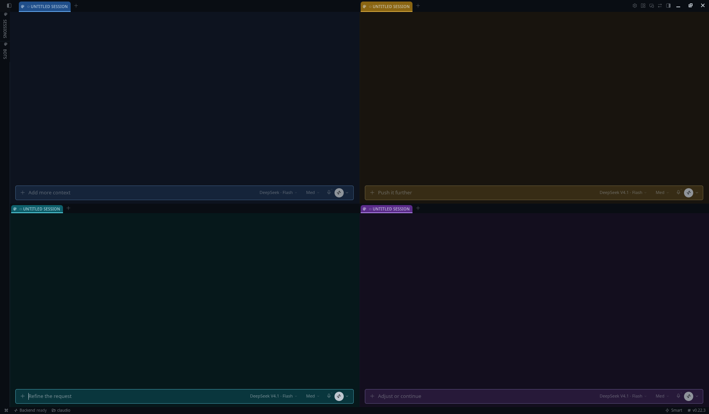
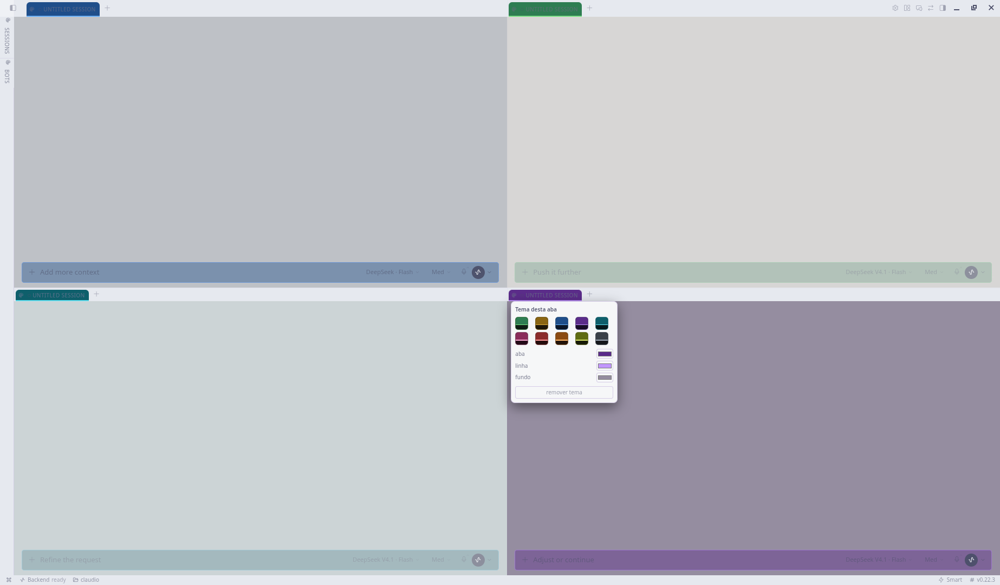

# Tab Tint — per-tab themes for Hermes Desktop

Give each tab in the Hermes Desktop app its own colour, independent of the app
theme. Four things are tinted per tab: the **tab chassis**, the **divider
lines**, the **chat surface** behind the conversation, and the **composer**
(the input box) — plus the **text colour**, so a light theme stays readable on
a light tab and a dark one on a dark tab.

Switch tabs and the app is back to its own colours.

Built for people who keep several sessions open side by side and need to know
at a glance which one they are typing into — the same reason a terminal
emulator gives each window a colour.

Four coloured tabs in a 2×2 layout, dark app theme:



The same four tabs under the light app theme:



## What it does

| Layer | What is painted |
|---|---|
| **Tab** | the tab's own fill and border |
| **Line** | the tab border, the active tab's underline, and the composer border |
| **Background** | the conversation surface of that tab |
| **Composer** | the input box, in a tone between background and tab |
| **Text** | the text colour of the tab, the conversation and the composer |

Text is a layer of its own on purpose: colour alone breaks the moment the tab
background and the app theme disagree — light text on a light tab, or dark text
on a dark tab. Every preset carries its own text colour, and the secondary and
muted tones are derived from it, so a coloured tab reads correctly whether the
app is in light or dark mode.

On top of the colour, the plugin rounds the top corners of every tab and puts
a small gap between tabs, so a strip of coloured tabs reads as separate
objects instead of one continuous bar.

Twenty presets ship in the picker — ten colours (green, amber, blue, purple,
cyan, pink, red, orange, lime, graphite) in both a **dark** and a **light**
variant — plus four fine-tuning colour inputs if you want an exact hue. Every
preset is contrast-checked against its own background and composer (WCAG:
text/background ≥ 15:1, text/composer ≥ 10:1, text/tab ≥ 4.6:1).

## Requirements

- Hermes Desktop (`hermes desktop`). This is a desktop plugin only — it does
  nothing in the CLI, the TUI or the gateway.
- Hermes Agent `>= 0.22.0`. Tested on `v0.22.3`.

## Install

From the repository (recommended — it is versioned and removable):

```bash
hermes plugins install filhocf/hermes-tab-tint
```

Then enable it: **Capabilities → Plugins → Tab Tint**. A desktop plugin that
ships inside a unified package starts switched off by design, so it will not
paint anything until you flip that toggle.

Manual install, if you prefer a single file:

```bash
git clone https://github.com/filhocf/hermes-tab-tint
mkdir -p ~/.hermes/desktop-plugins/tab-tint
cp hermes-tab-tint/desktop/plugin.js ~/.hermes/desktop-plugins/tab-tint/plugin.js
```

Do not use both routes at once: two copies of the same plugin `id` make the
loader reject one of them.

## Use

1. Click the **palette icon** at the start of the tab's title.
2. Pick a preset — the section matching your app mode is listed first, and both
   stay available — or set **tab / line / background / text** individually.
3. *remove theme* returns that tab to the app's own colours.

The same picker is available from the command palette: **⌘K → "Tema da aba em
foco"** (*Theme of the focused tab*).

Choices are stored per tab, so a colour survives switching the session behind
that tab, and other tabs are untouched.

## Tuning the tab chassis

Two constants at the top of the chassis block in `desktop/plugin.js`:

```js
const RADIUS = '7px'   // top corner radius
const GAP = '4px'      // gap between tabs
```

## How it works

The plugin writes a generated `<style>` element that overrides the app's own
CSS custom properties, scoped to the tab you painted:

| Target | Selector | Variables |
|---|---|---|
| tab | `[data-tree-tab="<key>"][role="tab"]` | `--tab-bg`, `--pane-tab-strip-bg`, `--pane-tab-active-bg`, `--pane-tab-active-accent` |
| conversation | `[data-chat-surface][data-session-anchor="<key>"]` | `--ui-chat-surface-background`, `--dt-card`, `--ui-text-primary`, `--dt-foreground`, `--foreground` |
| composer | `[data-slot="composer-surface"]` inside the surface | `--composer-fill` |
| tile block | `[data-pane-host="<key>"]` (split layouts) | same surface variables |

`<key>` is the same string on both sides — `workspace` for the primary tab,
`session-tile:<id>` for each tile — which is what makes one tab paintable
without touching its neighbours.

## Known limitations

- **Not in the Hermes plugin catalog, by design.** The catalog admission rule 8
  forbids a listed desktop plugin from reaching into the app's markup to
  restyle core UI, and `hermes plugins validate` flags this plugin's DOM
  reach. Getting it listed needs an SDK seam for per-tab theming; until that
  exists, this ships as a standalone repository. Installing it is the same
  two-part trust decision as any local plugin: you read the file and you keep
  it. The seam request is
  [NousResearch/hermes-agent#142616](https://github.com/NousResearch/hermes-agent/issues/142616).
- **It depends on internal DOM attributes and CSS variables.** A Desktop
  release can rename them; when that happens the plugin stops painting and
  leaves the app untouched (no error, no half-applied theme). Column-style
  (vertical) tab rails are already excluded.
- **Panel tabs get the chassis colour only.** `sessions`, `files`, `terminal`
  and other panes have no conversation surface, so there is no background,
  composer or conversation text to tint there.
- **Colours are per tab, not per profile.** The app's own theme picker stays
  per profile; this plugin deliberately does not touch it.
- **A theme saved before 0.2 has no text colour.** The plugin derives one from
  the background's luminance instead of discarding your choice; reopen the
  picker once to set it explicitly.

## Privacy

No network calls, no telemetry, no shell commands, no credentials. It reads
and writes only its own plugin storage (your colour choices) and applies CSS
inside the Desktop window.

## Uninstall

```bash
hermes plugins remove tab-tint
```

or delete `~/.hermes/desktop-plugins/tab-tint/` for a manual install.

## License

MIT — see [LICENSE](LICENSE).
